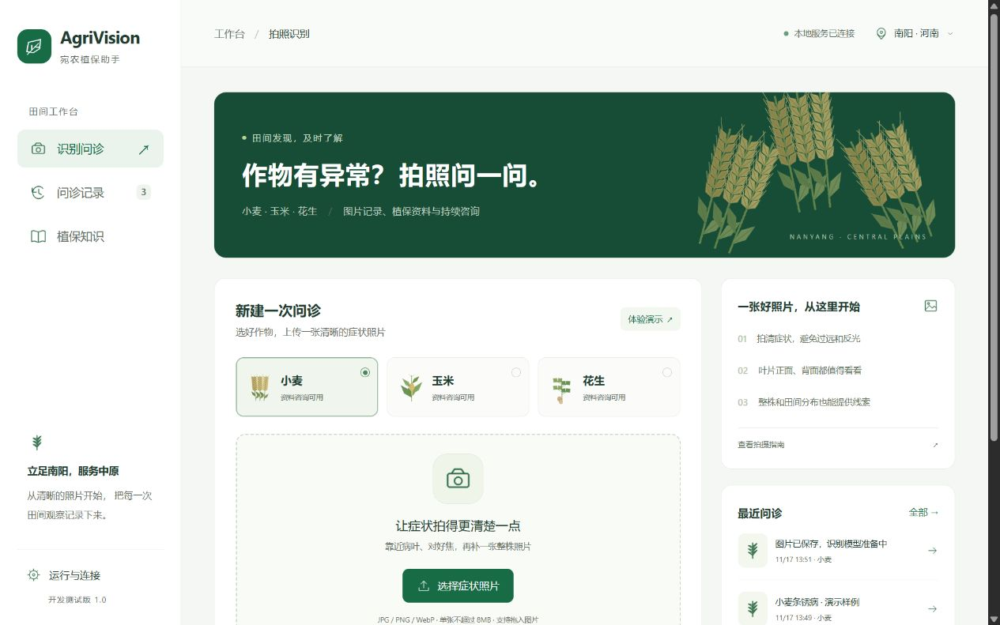

# AgriVision 宛农植保助手

面向河南南阳及周边农资服务的小麦、玉米、花生问诊软件。开发测试版 **1.0.0-dev.1** 已实现 uni-app 双端界面、FastAPI 后端、本地植保资料检索、问诊记录与对话，以及 PyTorch 数据、训练、评测和推理框架。



[查看手机尺寸实际界面](docs/previews/mobile-v1.jpg)。

## 本机启动

项目目录为 `F:\college\AgriVision`。环境已准备好时，在该目录运行：

```powershell
.\scripts\Start.ps1
```

打开 `http://127.0.0.1:8000`。接口文档位于 `http://127.0.0.1:8000/docs`。停止服务运行 `.\scripts\Stop.ps1`。

新环境使用 `.\scripts\Setup.ps1`，安装 CUDA 训练依赖使用 `.\scripts\Setup.ps1 -WithCuda`。详见[开发与模型接入说明](docs/development.md)。

## 当前可用功能

- 网页自适应布局与微信小程序共用页面，作物平铺选择、地区选择、生育期和症状备注。
- 图片上传、格式与质量检查、补充照片、问诊信息编辑、历史查询与删除。
- 明确标注的演示样例，可以体验结果、资料来源与连续咨询。
- 15 条植保资料卡，按作物与中文关键词检索；对话关联当前问诊。
- DeepSeek 后端适配，未配置密钥或调用失败时使用本地资料说明。
- 经过审核的产品资料匹配入口，用药问题进入标签规则流程。
- EfficientNet-B0 与 MobileNetV3-Small，分组数据清单、训练、评测、模型包导出和真实权重推理。

## 当前模型与资料状态

**正式病害权重尚未训练，DeepSeek 密钥尚未配置，公司产品目录为空。** 上传用户图片时如实返回模型准备状态；主动打开的演示记录独立标注，不伪装成真实识别。

模型框架已在 RTX 3060 Laptop、PyTorch 2.7.1 与 CUDA 12.6 上执行合成图片短训练、导出和加载检查。合成数据只证明代码链路可运行，不代表病害识别效果。真实模型需在独立数据及实拍验证后接入。

## 需求与实施文档

| 文档 | 内容 |
| --- | --- |
| [1.0 需求与验收](docs/requirements-v1.md) | 本版本功能、边界和验收条件 |
| [开发与模型接入](docs/development.md) | 启动、配置、小程序构建、数据处理、训练和评测 |
| [实施规划](docs/demo-plan.md) | 南阳作物病虫害范围与后续实施顺序 |
| [数据来源](docs/data-sources.md) | 13 项候选数据来源与许可、去重和采集计划 |
| [UI 与交互规范](docs/ui-spec.md) | 双端布局、控件选择、视觉与文案要求 |
| [验证记录](docs/validation.md) | 已执行检查和实际验证范围 |

## 开发命令

```powershell
npm run dev          # 前端热更新，本机 5173 端口
npm run typecheck    # TypeScript 与 Vue 类型检查
npm run build        # 网页构建
npm run build:mp     # 微信小程序构建
.venv\Scripts\python.exe -m pytest -q
.venv\Scripts\python.exe scripts/smoke_ml.py
```

微信小程序构建产物位于 `apps/client/dist/build/mp-weixin`，网页构建产物位于 `apps/client/dist/build/h5`。小程序还需真实 AppID 和真机可访问的后端地址。

## 项目结构

```text
apps/client/       uni-app、Vue 3 与 TypeScript
services/api/app/  FastAPI、问诊与对话、资料检索、产品规则
ml/agrivision_ml/  数据清单、模型、训练、评测和推理
configs/labels/   三种作物的内部标签映射
knowledge/        公开资料卡与产品资料结构
scripts/          环境准备、启动停止与模型链路检查
tests/           API、数据与模型测试
docs/            需求、设计、开发与验证记录
```

密钥、用户图片、数据库、训练数据、权重和本地缓存由忽略规则排除。当前服务面向本机开发测试；正式开放外网前需增加登录权限、HTTPS、配额与备份。
