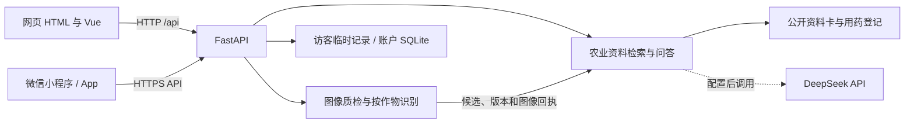

# 宛田观叶 · 系统架构与现行功能

更新于 2026-11-26。[本机命令](development.md) · [迭代计划](roadmap.md)

## 运行关系

本地前端开发端口为 5173，`/api` 代理到 8000。FastAPI 可以独立运行，也可以托管本地构建的 H5。GitHub Pages 提供静态网页预览。联网小程序和 App 通过配置的 API 地址访问服务。离线演示从同一份公开卡片构建，使用演示会话和回复。

## 功能与交互

| 功能 | 实现 |
| --- | --- |
| 首页 | 拍照识别、询问 AI 两个快捷入口可调整顺序。最近记录、参考资料、农业资讯在首页切换。资料支持作物筛选和正文查看 |
| 拍照与识别 | 访客可拍照或上传。`POST /api/crop-recognition` 接收整株照片给出作物候选。用户确认或手选作物后，`POST /api/cases` 保存症状照片并按作物识别。结果可补图、重试和接续对话 |
| 对话 | 登录后可直接询问 AI，也可从识别结果继续同一条记录。缺少必要信息时收集作物和生育期，再恢复原问题。回答、观察建议和来源各自可回看 |
| 账户与历史 | 游客识别使用临时记录，管理员登录后才启用 AI 对话与账户历史。接续照片时只移交选中的本次记录。账户记录使用 SQLite，图片存放在后端运行目录 |
| 参考说明 | 识别结果展示参考提示和模型版本。对话中的 AI 提示位于对应回答之后、输入区之前。置信度不足时用候选或补拍提示说明现有证据 |

- **桌面网页**使用上方单行页标题、返回及账户控件和左侧导航历史。首页两个快捷入口随可用宽度并排或换行。网页使用 `apps/client/index.html` 和编译后的静态资源。对话富文本随首条回答加载。
- **手机网页**使用小程序同样的首页与三栏底部导航。会话顶栏提供返回与历史。浏览器通过可视视口测量键盘遮挡。我的页面以账户信息开头。
- **微信小程序**使用微信胶囊尺寸确定顶部布局，使用微信键盘事件同步输入栏。微信的预览包与联网包分别构建。
- **App**使用原生状态栏、底部安全区和键盘事件。手机主页、照片、对话、历史返回与账户复用同一组组件。网页和微信的非图片文件选择分别使用平台提供的入口，App 内测可添加照片。

## 模块边界

| 目录或入口 | 职责 |
| --- | --- |
| [客户端页面](../apps/client/src/pages/index/index.vue) | 组合首页、拍照、会话和账户，协调翻页、登录接续与数据刷新 |
| [客户端组件](../apps/client/src/components) | 桌面和移动顶栏、导航、首页、图片输入、对话与结果视图 |
| [客户端业务和平台逻辑](../apps/client/src/lib) | `navigation.ts` 管理返回栈，`viewport.ts` 统一浏览器和原生窗口测量，`transport.ts` 与 `api.ts` 处理 HTTP、身份和上传 |
| [API 启动](../services/api/app/main.py) | ASGI 入口，保持 `app.main:app` 启动命令 |
| [API 组装](../services/api/app/application.py) | 组装路由与服务，接收运行配置，调用识别、存储和问答 |
| [记录结果](../services/api/app/case_views.py) | 组织对外记录、照片识别消息、参考资料和访问令牌 |
| [图像服务](../services/api/app/models.py) | `imaging.py` 质检，`crop_recognition.py` 做作物候选，`models.py` 按作物加载病害模型，`evidence.py` 和 `recognition.py` 汇总回执 |
| [账户与存储](../services/api/app/repository.py) | `auth.py` 核验管理员，`repository.py` 隔离访客和账户，`store.py` 持久化 |
| [问答与资料](../services/api/app/chat.py) | `context.py` 和 `intake.py` 恢复待答问题，`knowledge.py` 检索资料和核验登记，`chat.py` 组织本地或 DeepSeek 回答 |
| [训练与推理](../ml/agrivision_ml) | 筛选、预处理、分组划分、训练、校准、评估和模型包推理 |
| [公开资料](../knowledge) | 结构化资料卡、资讯和用药登记。当前有 15 张资料卡和 3 条资讯，登记表为空 |

## 数据与接口约定

- 客户端通过 `GET /api/meta` 获取模型状态。小麦 V1 有条锈病、叶锈病、白粉病、未见明显特征、其他症状五个输出。作物分类和病虫识别独立部署。配置、权重和每次训练的标签顺序分别管理。 [小麦 V1 模型卡](model-card-wheat-v1.md)
- 模型架构、标签与尺寸规则来自同一个模型包；知识卡按病害 ID 独立关联。缺少某类卡片时仍可识别，资料模块只返回已有通用建议。
- 识别服务返回结构化线索，问答结合问题、田间信息和可核验资料解释线索。图片留在识别链路。DeepSeek 和管理员信息从服务端设置读取。
- `data/wheat-leaf-spike-03` 是已预处理的八类小麦工作集，逐图人工复核仍需继续。本轮七组实验保持清单固定，在线增强只作用于训练读取。按验证表现选出模型后接入本地 API；此前的五类 V1 保留为历史基线。 [筛图与训练清单](recognition-training-checklist.md)
- 界面样式使用共享颜色和间距。浅色使用低饱和绿灰，深色使用黑灰。微信胶囊、App 安全区、浏览器视口分别由各平台处理。
