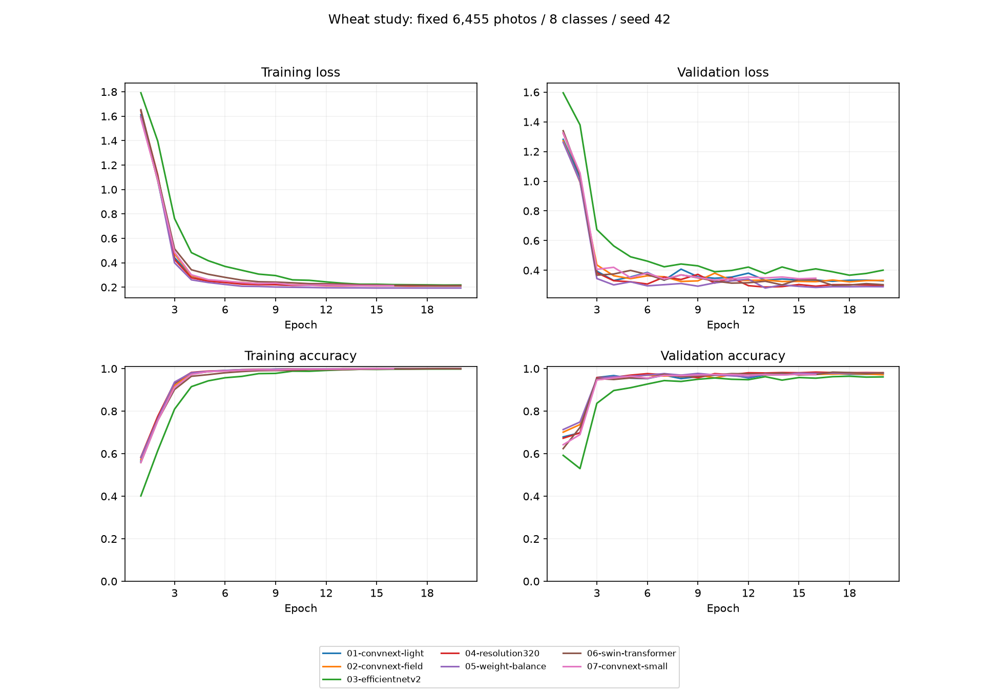

# 小麦数据处理、训练与本地联调清单

更新于 2026-11-27。本轮使用 Windows 本机现有的 `.venv`，固定数据目录为 `data/wheat/prepared`。**预处理与七组实验已完成；本机 API 已接入 Swin-T。结果集中在 `artifacts/experiments/wheat-study`，第 7 节是唯一的本轮对比报告。**

## 0. 先看运行顺序

| 步骤 | 做什么 | 是否保存图片 |
| --- | --- | --- |
| 1. 筛选、预处理，已完成 | 核验照片、整理方向、等比缩图、查重、按采集组划分训练/验证/测试 | 工作图保存在 `data/wheat/prepared/images` |
| 2. 数据增强，在训练读取时执行 | 随机翻转、旋转、颜色变化；可比较轻微模糊、压缩和噪声 | 仅存在内存，直接交给这一批训练 |
| 3. 模型训练 | 从 ImageNet 预训练权重开始，先适配分类头，再全网微调 | 保存权重、配置、逐轮指标和曲线 |
| 4. 评估 | 按验证集选择模型；校准后报告留出测试集表现 | 保存逐图预测、混淆矩阵和指标 |
| 5. 本地联调 | 后端加载选中权重，网页通过 HTTP API 上传照片 | 后端保存临时记录，模型保持常驻 |

先在 PowerShell 进入项目目录。以下命令均使用这一目录和同一个虚拟环境，无需新建环境。

```powershell
cd F:\college\AgriVision
```

## 1. 当前数据与筛选

本轮共有 **6,455 张照片、8 个类别、1,290 个采集组**。训练 4,621 张、验证 981 张、测试 853 张。同一采集组留在同一划分中。各轮模型比较固定使用这些划分，增强只作用于训练集。

| 类别 | 训练 | 验证 | 测试 | 合计 |
| --- | ---: | ---: | ---: | ---: |
| 小麦条锈病 | 727 | 217 | 98 | 1,042 |
| 小麦叶锈病 | 539 | 127 | 80 | 746 |
| 小麦白粉病 | 530 | 147 | 121 | 798 |
| 小麦赤霉病 | 1,159 | 232 | 214 | 1,605 |
| 小麦颖枯病 | 307 | 42 | 58 | 407 |
| 小麦黄矮病 | 300 | 52 | 56 | 408 |
| 健康参考 | 815 | 112 | 174 | 1,101 |
| 小麦壳针孢叶枯病 | 244 | 52 | 52 | 348 |

来源为河南原阳、MSWDD2022 和 JIC。这里的健康参考表示这组标签中的健康图，实际识别时仍需考虑模型未覆盖的症状。筛选表中仍有待复核项目，当前工作集没有被逐张人工确认过。来源、许可、别名和排除原因见 [数据来源](data-sources.md)。

打开工作图，可以按类别查看：

```powershell
explorer F:\college\AgriVision\data\wheat\prepared\images
```

| 文件 | 怎么使用 |
| --- | --- |
| `images/<类别 ID>/` | 查看工作照片 |
| `sources.csv` | 用工作图文件名追溯原图、来源和拍摄部位 |
| `manifest.csv` | 每张图的类别、采集组、训练/验证/测试归属 |
| `labels.json` | 模型实际使用的标签顺序与中文名称 |
| `manifest.report.json` | 各类数量、分辨率、来源和排除原因 |

工作图长边不超过 1,024 像素，保持原有长宽比。因此 81 种分辨率是正常的；统一成模型输入尺寸在读图时完成。当前模型使用等比缩放并补边，避免将长叶片或麦穗直接拉成方形。

如需继续筛图，打开这张表，修改后保存为 CSV UTF-8：

```powershell
Invoke-Item F:\college\AgriVision\data\wheat\review\leaf-spike-review.csv
```

`decision=keep` 是保留候选，`drop` 是排除，空白是待复核。`label` 是类别 ID；`class_name`、`part`、`note` 辅助核对。照片编号本身不决定标签。下面只检查筛选表，不改变现有工作图：

```powershell
.\.venv\Scripts\python.exe -m ml.agrivision_ml.preprocessing.wheat_review --review data/wheat/review/leaf-spike-review.csv --check
```

原来的 `wheat-leaf-spike-03` 已原地移动为 `data/wheat/prepared`，图片、类别、划分和 manifest SHA-256 均未变化。筛选表的修改不会自动改写工作集。后续确认数据修改后统一更新当前工作集和划分，再启动新一组对照；不要为每次训练复制一份数据。

## 2. 数据增强在哪里，参数什么意思

增强代码集中在 [augmentation.py](../ml/agrivision_ml/augmentation.py)。训练入口 [train.py](../ml/agrivision_ml/train.py) 的 `Images` 负责读图，再调用它。

- `--resize letterbox`：等比缩放并居中补边，保持叶片和麦穗的形状。训练、验证、测试、接口推理共同读取这个配置。
- `--augmentation light`：水平翻转、±10° 旋转，亮度/对比度幅度 0.12、饱和度幅度 0.10。
- `--augmentation field`：小幅平移（最多宽高的 3%）、0.95–1.05 倍缩放、±10° 旋转和上述颜色变化；再以 15% 概率选择一种成像退化。
- 退化候选：3×3 高斯模糊（σ=0.1–0.7）、JPEG 质量 75–95，或高斯噪声 σ=3/255。最后一种相当于 8 位像素大约 3 个灰度级的标准差。每次至多抽一种退化，避免强烈叠加后掩盖病斑。

这些是待比较的轻量起点，本轮第 1、2 组结果支持保留轻增强。第 2 组同时改变小幅几何扰动和成像退化，因此结果说明的是整套增强方案的差别，不能单独归因于噪声。实现复用 TorchVision/Pillow 的标准变换。 [TorchVision 变换说明](https://docs.pytorch.org/vision/stable/transforms.html)

示例图：[原图、轻增强与田间增强对照](../artifacts/experiments/wheat-study/augmentation-preview.png)。

**数据量不需要靠落盘复制补成一样。** 当前训练每个 epoch 遍历全部 4,621 张训练照片。类别不平衡通过损失权重处理，第 5 组另外比较平方根权重：原逆频率权重给稀少类更大的学习权重；开平方会减轻这种放大程度，观察误报和逐类召回的变化。这与抽样重复照片是两种不同操作。

## 3. 运行一组完整训练

本轮机器为 RTX 3060 Laptop 6 GiB，使用 BF16 混合精度，每批 16 张，先冻结骨干 2 个 epoch，再全网微调。原有数据和模型缓存都放 F 盘。

先在同一 PowerShell 窗口指定权重缓存：

```powershell
$env:TORCH_HOME = 'F:\college\AgriVision\.cache\torch'
```

下面是选中 Swin-T 的完整训练命令，**已有运行结果时用于阅读和复现，不要对正在运行或已保存的结果目录重复执行**。每次训练只有实验结果目录不同，数据目录固定为 `data/wheat/prepared`。

```powershell
.\.venv\Scripts\python.exe -m ml.agrivision_ml.train --data-root data/wheat/prepared/images --manifest data/wheat/prepared/manifest.csv --labels data/wheat/prepared/labels.json --output artifacts/experiments/wheat-study/06-swin-transformer/wheat --architecture swin_t --device cuda --input-size 224 --resize letterbox --augmentation light --batch-size 16 --lr 0.0001 --freeze-epochs 2 --precision bf16 --epochs 20 --patience 6 --workers 0
```

| 参数 | 作用，以及改哪里 |
| --- | --- |
| `--architecture swin_t` | 选择模型；构建代码在 `model.py` |
| `--input-size 224` | 输入 RGB 方图边长；`letterbox` 保持原图比例并补边 |
| `--augmentation light` | 选择增强方案；具体强度在 `augmentation.py` |
| `--batch-size 16` | 每次更新读 16 张；本轮每个 epoch 共 289 次参数更新 |
| `--lr 0.0001` | AdamW 初始学习率，之后按余弦调度降低 |
| `--freeze-epochs 2` | 前两轮适配八类分类头，随后训练整个网络 |
| `--precision bf16` | 当前显卡支持的混合精度；较老显卡可改 `fp32` 或 `amp` |
| `--epochs 20 --patience 6` | 最多 20 轮；验证 Macro-F1 连续 6 轮未改善则早停 |
| `--grad-clip 1` | 默认梯度裁剪阈值，限制单次更新过大；记录裁剪前范数供检查 |
| `--class-weight-power 1` | 默认逆频率类别权重；第 5 组比较 `0.5` |
| `--freeze-bn` | 可选，固定 BatchNorm 运行统计；本轮 EfficientNetV2 使用它 |
| `--workers 0` | 当前 Python 进程读图，便于 Windows 本机调试 |
| `--output` | 结果目录；末尾 `wheat` 与 API 按作物加载的目录结构对应 |

只查看所有可选参数，不会开始训练：

```powershell
.\.venv\Scripts\python.exe -m ml.agrivision_ml.train --help
```

## 4. 查看每轮训练结果

```powershell
explorer F:\college\AgriVision\artifacts\experiments\wheat-study
```

每个实验的 `wheat` 子目录包含：

| 产物 | 阅读方法 |
| --- | --- |
| `training-curves.png` | 训练/验证 loss 和准确率曲线，每个 epoch 更新 |
| `training.json` | 逐轮 loss、准确率、Macro-F1、混淆矩阵、耗时、学习率 |
| `weights.pt` | 验证 Macro-F1 最佳的参数 |
| `last-weights.pt` | 最后一轮参数，用于分析训练后期异常 |
| `metadata.json` | 架构、类别、尺寸规则、增强、最佳轮次、配置、数据摘要和代码提交 |
| `predictions-val.csv` / `predictions-test.csv` | 每张图的真实类别、预测、分数、采集组和来源，方便定位错图 |
| `confusion-val.png` / `confusion-test.png` | 左图是张数，右图是按真实类别归一化的召回 |
| `evaluation-val.json` / `evaluation-test.json` | 总体、逐类、按来源和阈值筛选后的指标 |

`train_images_seen=4621` 表示这一轮完整遍历了训练集。`max_gradient_norm` 是裁剪前最大梯度范数，结合 loss 与学习率判断更新是否异常。最佳轮次保存在 `metadata.json` 的 `validation.epoch`。

## 5. 校准、测试和单图推理

训练完成后，先在验证集调温度和结果阈值。以下以选中模型目录说明；查看其他实验时只替换 `--bundle` 后的目录。温度校准不改变第一候选排序，用于调整分数和给出明确结果的覆盖率。

```powershell
.\.venv\Scripts\python.exe -m ml.agrivision_ml.calibrate --bundle artifacts/experiments/wheat-study/06-swin-transformer/wheat --data-root data/wheat/prepared/images --manifest data/wheat/prepared/manifest.csv --device cuda
```

生成 853 张留出测试照片的完整报告和混淆矩阵：

```powershell
.\.venv\Scripts\python.exe -m ml.agrivision_ml.experiment_report --bundle artifacts/experiments/wheat-study/06-swin-transformer/wheat --data-root data/wheat/prepared/images --manifest data/wheat/prepared/manifest.csv --split test --device cuda
```

把下面的照片路径换成自己的实际路径，运行一次单张推理。用 CPU 时将末尾 `cuda` 改成 `cpu`：

```powershell
.\.venv\Scripts\python.exe -m ml.agrivision_ml.inference --bundle artifacts/experiments/wheat-study/06-swin-transformer/wheat --image "F:\photos\wheat-sample.jpg" --device cuda
```

验证集用于模型和方法选择，测试集用于报告最终表现。七组中的后两种架构在查看前五组测试分数之前已确定，仍只按验证 Macro-F1 选择。已重复查看过的测试集不能替代未来新田块、新季节照片的独立验证。

## 6. 读代码的顺序

| 想理解什么 | 文件与入口 |
| --- | --- |
| 筛选表如何生成工作集 | [wheat_review.py](../ml/agrivision_ml/preprocessing/wheat_review.py) 的 `build_dataset()` |
| 校正方向、等比缩图 | [images.py](../ml/agrivision_ml/preprocessing/images.py) |
| 查重、采集组和划分 | [manifest.py](../ml/agrivision_ml/preprocessing/manifest.py)、[groups.py](../ml/agrivision_ml/preprocessing/groups.py)、[splits.py](../ml/agrivision_ml/preprocessing/splits.py) |
| 模型架构、分类头替换 | [model.py](../ml/agrivision_ml/model.py) 的 `build_model()`、`classification_head()` |
| 尺寸与在线增强 | [augmentation.py](../ml/agrivision_ml/augmentation.py) |
| 读图、反向传播、冻结、早停 | [train.py](../ml/agrivision_ml/train.py) 的 `Images` 和 `train()` |
| loss/acc 曲线 | [training_curves.py](../ml/agrivision_ml/training_curves.py) |
| 分数校准 | [calibrate.py](../ml/agrivision_ml/calibrate.py) |
| 逐图评估、来源统计和混淆矩阵 | [experiment_report.py](../ml/agrivision_ml/experiment_report.py) |
| 部署共用的读权重与推理 | [inference.py](../ml/agrivision_ml/inference.py) 的 `Predictor` |
| API 的按作物缓存与识别 | [models.py](../services/api/app/models.py) 的 `ModelRegistry` |

Python 版本、训练依赖和缓存设置分别见 [版本文件](../.python-version)、[requirements-ml.txt](../requirements-ml.txt)、[uv.toml](../uv.toml)。修改增强或模型构建前，先看对应文件的中文注释；训练主循环负责调用这些独立模块。

## 7. 本轮七组实验与历史问题

原 MobileNetV4-Conv-Small 是约 250 万参数的 CNN，八类训练最佳第 8 轮验证准确率 85.93%、Macro-F1 82.56%。随后 loss 波动并升高，第 13 轮验证准确率 69.93%、loss 19.762。小批次 BatchNorm、解冻后更新幅度和难例分数均值得检查；历史末轮没有留权重，不能认定只有一个原因。已保存的第 8 轮复评为 843/981 正确。BN 统计重估对照只小幅改变准确率，也不足以解释全部下降。

本轮改善输入几何、较低学习率、梯度裁剪、保留末轮权重，并比较以下成熟网络。每组从 ImageNet 权重重新开始，种子 42，每批 16 张，最多 20 个完整 epoch。所有结果统一放在 `artifacts/experiments/wheat-study`。

| 实验目录 | 架构或变化 | 要回答的问题 |
| --- | --- | --- |
| `01-convnext-light` | ConvNeXt-Tiny，224，轻增强 | 中等规模卷积模型基线 |
| `02-convnext-field` | 同一模型和尺寸，田间增强 | 轻微成像退化与空间扰动是否有收益 |
| `03-efficientnetv2` | EfficientNetV2-S，固定 BN 统计 | 比较另一种 CNN，采用前两组较好的增强 |
| `04-resolution320` | 前三组较好架构，尺寸提高到 320 | 小病斑细节是否受益 |
| `05-weight-balance` | 前四组较好方案，类别权重开平方 | 减弱稀少类损失权重是否改善混淆 |
| `06-swin-transformer` | Swin-T，224 | 比较窗口注意力 Transformer |
| `07-convnext-small` | ConvNeXt-Small，224 | 更大一级卷积模型是否有收益 |

第 6、7 组沿用前两组中较好的增强。`study.json` 记录每组完整训练命令、调整理由和实际参数；`summary.json` 记录结果和验证集选中的模型。七组结果均已写全，具体命令以 `study.json` 为准。

ConvNeXt 使用卷积与 LayerNorm，Swin 使用分层窗口自注意力；两者不依赖普通 BatchNorm 的跨批运行统计。EfficientNetV2 由 Fused-MBConv 和 MBConv 组成，仍是 CNN。参数规模需与数据、预训练和正则化一起比较，并非越大必然越准确。 [ConvNeXt · CVPR 2022](https://openaccess.thecvf.com/content/CVPR2022/html/Liu_A_ConvNet_for_the_2020s_CVPR_2022_paper.html) · [EfficientNetV2 · ICML 2021](https://proceedings.mlr.press/v139/tan21a.html) · [Swin-T 官方实现与论文入口](https://docs.pytorch.org/vision/main/models/generated/torchvision.models.swin_t.html)

### 7.1 已完成的结果

七组实验全部结束，共 136 个完整 epoch；每轮读取 4,621 张训练图、实际更新 289 次。前六组各 20 轮，第七组验证 Macro-F1 连续六轮未改善，在第 16 轮早停。始终使用原来的 03 清单，未复制新数据集。

按预定的验证 Macro-F1 选择 **06-swin-transformer：Swin-T，224 输入，轻增强，逆频率损失权重**。它是分层窗口注意力 Transformer，约 2,753 万参数。验证准确率 98.37%、Macro-F1 97.71%；留出测试 844/853 正确，准确率 98.94%、Macro-F1 98.90%。

| 实验 | 实际 / 最佳 epoch | 验证准确率 | 验证 Macro-F1 | 测试准确率 | 测试 Macro-F1 | 明确结果覆盖率 |
| --- | ---: | ---: | ---: | ---: | ---: | ---: |
| 01-convnext-light | 20 / 17 | 97.66% | 96.98% | 98.94% | 98.90% | 99.41% |
| 02-convnext-field | 20 / 18 | 97.66% | 96.52% | 98.36% | 98.17% | 98.48% |
| 03-efficientnetv2 | 20 / 18 | 96.43% | 95.33% | 97.66% | 97.25% | 37.87% |
| 04-resolution320 | 20 / 16 | 98.37% | 97.69% | 98.94% | 98.75% | 99.41% |
| 05-weight-balance | 20 / 19 | 97.96% | 97.21% | 98.94% | 98.82% | 99.77% |
| 06-swin-transformer | 20 / 17 | 98.37% | 97.71% | 98.94% | 98.90% | 99.77% |
| 07-convnext-small | 16 / 10 | 97.25% | 96.42% | 97.66% | 97.44% | 98.48% |

第 6 组与第 4 组验证 Macro-F1 只差约 **0.02 个百分点**，两者测试准确率相同。这是一次固定划分、种子 42 的开发比较，不能解释为统计上已证明 Swin 普遍优于 ConvNeXt。第 1、4、5、6 组测试准确率同为 98.94%，具体错图和各类表现不同。

选择记录：前五组训练结束时先按验证集选中第 4 组；加入预先确定的第 6、7 组后仍按验证 Macro-F1 选择。第 1 组为了提早接通本地 API，提前做过留出测试；后续训练参数选择只读取验证结果。当前测试集已经查看过，下一轮外部泛化验收应另留新田块、新季节的独立照片。

### 7.2 容量与 CPU 成本

| 实验 | 架构 | 八类参数量 | 输入 | 训练分钟 | CPU 中位 / P95 毫秒 |
| --- | --- | ---: | ---: | ---: | ---: |
| 01 | convnext_tiny | 27,826,280 | 224 | 28.8 | 63.1 / 75.5 |
| 02 | convnext_tiny | 27,826,280 | 224 | 29.4 | 71.3 / 102.0 |
| 03 | efficientnet_v2_s | 20,187,736 | 224 | 28.9 | 63.1 / 72.9 |
| 04 | convnext_tiny | 27,826,280 | 320 | 33.6 | 116.8 / 128.7 |
| 05 | convnext_tiny | 27,826,280 | 320 | 33.7 | 113.9 / 127.3 |
| 06 | swin_t | 27,525,506 | 224 | 26.6 | 70.9 / 78.2 |
| 07 | convnext_small | 49,460,840 | 224 | 23.2 | 111.7 / 125.8 |

训练设备为 RTX 3060 Laptop 6 GiB，BF16；分钟数是逐 epoch 计时之和，不包含首次下载、初始化与独立评估。CPU 为 Ryzen 9 5900HX，PyTorch 2.7.1，固定 4 线程。各模型预热 8 次后，使用每类前两张测试照片轮换进行 80 次串行单图推理，包含读图、预处理和网络前向，不包含 HTTP、数据库和首次加载。训练已全部结束后才测量。相同架构也会有系统负载与缓存波动，以上不是并发吞吐测试。

最终 Swin-T 权重约 105 MiB；本机 API 热身后的进程工作集约 707 MiB、私有内存约 1,487 MiB。这些是 Windows 本机观测，不能直接当作云 Linux 实例用量。先在现有云机部署一个模型进程，测实际延迟、内存和并发；多个模型 worker 会各自加载权重。

本轮结论：

- 提高输入细节有收益：ConvNeXt-Tiny 从 224 提到 320，验证 Macro-F1 从 96.98% 到 97.69%，同时 CPU 耗时增加。
- 田间增强方案未胜过轻增强：第 2 组验证 Macro-F1 96.52%。本轮整套扰动没有收益，不能据此认定所有噪声增强都无效。
- 减弱类别权重未胜过原方案：第 5 组验证 Macro-F1 97.21%，保留原逆频率权重。
- 更大模型未带来收益：ConvNeXt-Small 约 4,946 万参数，验证 Macro-F1 96.42%，本轮不选它部署。
- EfficientNetV2-S 在本轮 224 输入和固定 BN 配置下，测试 Top-1 97.66%，但校准后的明确结果覆盖率只有 37.87%。实际使用会频繁要求补拍。该结果不是这个架构充分调参后的性能上限。

### 7.3 曲线、逐类表现与错例



| 实验 | 训练曲线 | 验证混淆矩阵 | 测试混淆矩阵 |
| --- | --- | --- | --- |
| 01 | [loss / acc](../artifacts/experiments/wheat-study/01-convnext-light/wheat/training-curves.png) | [验证](../artifacts/experiments/wheat-study/01-convnext-light/wheat/confusion-val.png) | [测试](../artifacts/experiments/wheat-study/01-convnext-light/wheat/confusion-test.png) |
| 02 | [loss / acc](../artifacts/experiments/wheat-study/02-convnext-field/wheat/training-curves.png) | [验证](../artifacts/experiments/wheat-study/02-convnext-field/wheat/confusion-val.png) | [测试](../artifacts/experiments/wheat-study/02-convnext-field/wheat/confusion-test.png) |
| 03 | [loss / acc](../artifacts/experiments/wheat-study/03-efficientnetv2/wheat/training-curves.png) | [验证](../artifacts/experiments/wheat-study/03-efficientnetv2/wheat/confusion-val.png) | [测试](../artifacts/experiments/wheat-study/03-efficientnetv2/wheat/confusion-test.png) |
| 04 | [loss / acc](../artifacts/experiments/wheat-study/04-resolution320/wheat/training-curves.png) | [验证](../artifacts/experiments/wheat-study/04-resolution320/wheat/confusion-val.png) | [测试](../artifacts/experiments/wheat-study/04-resolution320/wheat/confusion-test.png) |
| 05 | [loss / acc](../artifacts/experiments/wheat-study/05-weight-balance/wheat/training-curves.png) | [验证](../artifacts/experiments/wheat-study/05-weight-balance/wheat/confusion-val.png) | [测试](../artifacts/experiments/wheat-study/05-weight-balance/wheat/confusion-test.png) |
| 06 | [loss / acc](../artifacts/experiments/wheat-study/06-swin-transformer/wheat/training-curves.png) | [验证](../artifacts/experiments/wheat-study/06-swin-transformer/wheat/confusion-val.png) | [测试](../artifacts/experiments/wheat-study/06-swin-transformer/wheat/confusion-test.png) |
| 07 | [loss / acc](../artifacts/experiments/wheat-study/07-convnext-small/wheat/training-curves.png) | [验证](../artifacts/experiments/wheat-study/07-convnext-small/wheat/confusion-val.png) | [测试](../artifacts/experiments/wheat-study/07-convnext-small/wheat/confusion-test.png) |

本轮没有重现历史训练后期 loss 升到 19.762 的现象。训练准确率接近 100%，验证与测试仍有错误，不能因此宣布消除了过拟合。历史对照同时更换了架构、输入处理、学习率、批量与数值训练设置，不能把改善全部归因于某一个因素。

曲线里的 loss 是带类别权重和 0.03 标签平滑的交叉熵，不会因为准确率达到 100% 就降到 0。评估 JSON 中的 nll 是未加类别权重、未作标签平滑的普通交叉熵，数值不能直接混用。温度校准用于分数和门限，不改变最高分的类别。

最终模型的完整测试召回：

| 类别 | 测试照片 | 正确 | 召回率 |
| --- | ---: | ---: | ---: |
| 小麦条锈病 | 98 | 97 | 98.98% |
| 小麦叶锈病 | 80 | 79 | 98.75% |
| 小麦白粉病 | 121 | 119 | 98.35% |
| 小麦赤霉病 | 214 | 214 | 100.00% |
| 小麦颖枯病 | 58 | 57 | 98.28% |
| 小麦黄矮病 | 56 | 56 | 100.00% |
| 未发现已支持病害的明显特征 | 174 | 170 | 97.70% |
| 小麦壳针孢叶枯病 | 52 | 52 | 100.00% |

| 测试来源 | 张数 | 准确率 |
| --- | ---: | ---: |
| mswdd2022 | 149 | 100.00% |
| henan-yuanyang-15621359 | 547 | 99.45% |
| jic-7307816 | 157 | 96.18% |

测试共 9 张分类错误，主要涉及健康参考与病害、白粉病与颖枯病等混淆。校准温度 0.85、最高分门限 0.65、分差门限 0.25；测试接受 851/853 张，接受部分正确率 98.94%。高分仍可能错判，页面已说明分数不代表确诊概率。

验证集错图 16 张、来自 9 个采集组，已输出本机的 `validation-errors.png` 和 `predictions-val.csv`，可回到原图逐张复核。其中采集组 **7e868779e02c6e113d4d** 的两张近似麦穗图分别标为颖枯病与健康参考，是需优先核对的候选标签问题。两张都在验证集，没有因此跨到训练集；本轮没有根据模型预测擅自改标签。

下一步优先复核错图与组内标签，再补不同地区、季节、拍摄设备和模型未覆盖的病害/非小麦照片。颖枯病、黄矮病和壳针孢叶枯病当前各自只有一个数据来源；同来源留出分数不能代表跨来源识别。数据调整后统一更新当前工作集和清单，不为每个训练版本复制数据。

### 7.4 本地接口与网页验证

本机已加载选中的 Swin-T，模型版本 `20261125-202036`，使用 CPU。网页地址：`http://127.0.0.1:8000/?mode=live`。

- 各类各取第一张留出图，API 输出与直接推理 8/8 一致；其中 7/8 符合数据标签，一张白粉病图误判为颖枯病。这是已知模型错例，计入全量测试，不将接口测试当作独立准确率估计。
- 访客可以识别，继续 AI 对话必须登录。补充灰色质检控制图后，接口保留原照片证据，并对不合格图提示重拍。
- 实际通过网页文件选择器上传赤霉病与颖枯病照片，显示相应结果。缺少资料卡的颖枯病仍可识别，只给已有的通用观察提示。
- 检查 1440×900 桌面和 390×844 手机网页布局，结果弹窗可关闭、正文内部滚动、底部操作可达。点击继续对话弹出登录，取消登录返回同一条识别记录；浏览器错误日志为 0。
- 本轮联调未发送付费 DeepSeek 请求，也未把浏览器模拟尺寸称为微信真机验收。API 实测记录在本机 `api-final.json`、`http-final.json`，截图为 `web-final-desktop.png`、`web-final-mobile.png`。

### 7.5 提交检查

已检查 Git 管理的文本与相关 WeChat 测试历史。测试里原有具体格式的 AppID 和 provider token 是假测试值，现已换成明确的 test-only 占位文本；当前提交检查未发现真实密钥。真实本机设置继续放在忽略的 `.env`、`.env.wechat.local` 和 `secrets` 中。配置字段名和空白示例保留，实际值由本机注入。

已有 WeChat 构建测试新增公开文件检查，发现具体 AppID、常见凭据格式、私钥头或被跟踪的本地配置目录时失败，错误只打印位置和类型。旧历史中的假测试值未重写历史。本轮最终回归：前端 59 项通过，模型/评估与 API 注册 18 项通过；公开文件检查包含在前端测试中。实验表格、曲线和汇总指标跟随代码提交；原始照片、权重、本地环境和浏览器运行记录留在本机。


## 8. 接入本地 API 与后续部署

选中的包已标记为内部测试。重新部署时，可用下列命令检查原清单的留出结果，并单独保存启用报告：

```powershell
.\.venv\Scripts\python.exe -m ml.agrivision_ml.evaluate --bundle artifacts/experiments/wheat-study/06-swin-transformer/wheat --data-root data/wheat/prepared/images --manifest data/wheat/prepared/manifest.csv --device cpu --activate-experimental --report-name activation
```

内部测试不代表完成独立田间验证。本机 `.env` 已设置为：

- `AGRIVISION_MODEL_DIR=artifacts/experiments/wheat-study/06-swin-transformer`：含有 `wheat` 子目录的目录。
- `AGRIVISION_DEVICE=cpu`：本机常驻 CPU 推理，也可切换为 `cuda`。
- `AGRIVISION_ALLOW_EXPERIMENTAL_MODELS=1`：允许本地加载该内部测试模型。

Git 中保存代码、指标与曲线，模型权重不随仓库提交。云端克隆代码后，还需另外上传所选目录的 weights.pt 和 metadata.json，并配置模型目录；云端推理不需要整份训练图片。

模型标签以模型包为准；知识卡按病害 ID 独立查找。某一类资料尚未补齐时仍能返回识别候选，并给出通用的补拍/记录建议；不会凭空生成具体药名和剂量。

构建网页后启动已有本地服务：

```powershell
npm run build
```

```powershell
.\scripts\Start.ps1
```

网页打开 `http://127.0.0.1:8000`，接口文档为 `http://127.0.0.1:8000/docs`。`GET /api/meta` 应显示当前小麦模型的八个类别和新版本。前端上传照片到 `POST /api/cases`，后端加载并缓存模型、执行质检和推理，再返回候选、分数、版本与资料。照片识别不调用 DeepSeek；登录后的对话是独立链路。

复测 CPU 性能（独立入口 [benchmark.py](../ml/agrivision_ml/benchmark.py)，输出模型目录下的 `benchmark-cpu.json`）：

```powershell
.\.venv\Scripts\python.exe -m ml.agrivision_ml.benchmark --bundle artifacts/experiments/wheat-study/06-swin-transformer/wheat --data-root data/wheat/prepared/images --manifest data/wheat/prepared/manifest.csv --device cpu --threads 4 --repeats 80 --warmup 8
```

停止本机服务：

```powershell
.\scripts\Stop.ps1
```

更详细的前后端开发方式见 [本地联调](development.md#本地联调)。先把本机识别与网页功能测通，再在云服务器测真实延迟、CPU、内存和并发。本机 CPU 线程测试不能直接保证某个云 vCPU 套餐的速度。需要降低成本时，再用选定大模型对比 ONNX、量化或蒸馏，并重新检查准确率、逐类召回和延迟。 [ONNX Runtime 量化](https://onnxruntime.ai/docs/performance/model-optimizations/quantization.html)


## 9. 多作物目录与分组交叉验证（2026-11-27）

数据按作物归档。`data/wheat/prepared` 是原 `wheat-leaf-spike-03`，只是移动，并未重新预处理或增加图片。清单哈希仍为 `a60c37cc8378d0916983e360689332006ef2a2e99cd0ad16b94fc7774c701383`。历史实验的 metadata 和 commands 保留当时路径；现在重跑命令使用本节路径。

| 目录 | 用途 |
| --- | --- |
| `data/<作物>/sources/<来源>` | 原始发布文件、许可和采集信息，保留原图 |
| `data/<作物>/review` | 筛选表、审计统计、待核对项目 |
| `data/<作物>/prepared` | 唯一的当前工作集；训练和各折都引用它 |
| `data/wheat/reference` | 国内原阳/陕西基线，现有筛选表仍引用其中照片，不可当无用文件删除 |
| `data/wheat/archive` | 原有叶片版和混合版归档，不参与当前训练；没有新复制图片 |
| `artifacts/experiments/<实验>` | 清单、权重、曲线、逐图预测等结果；编号只用于实验，不再编号复制数据 |

交叉验证回答“换一批采集组以后，这种方法是否仍然好用”。**它主要用于评估和选择方案，不等于给一个模型额外训练五次。** 五折各自从 ImageNet 权重重新训练；选出方案后再训练一个部署模型。五个模型集成会额外占用推理内存，本次不默认集成。

本轮先比较已有验证较好的 **Swin-T 224** 和 **ConvNeXt-Tiny 320**，比较的是完整方案，尺寸也不同。复用 sklearn 的 `StratifiedGroupKFold`，尽量平衡类别并保证采集/重复组完整。分组较大时每折张数不会完全相等，不能为凑数量拆散组。 [官方分组分层说明](https://scikit-learn.org/stable/modules/generated/sklearn.model_selection.StratifiedGroupKFold.html)

流程是：原训练+验证 5,602 张 → 五个外层折；每次取四折作为训练池，再在这个池内划出约 20% 的组作早停/校准验证。余下一折只做这次的外层评估。原测试 853 张完全排除在交叉验证之外。同一张开发图恰好被外层评估一次。该机制是固定内层验证的分组交叉验证，并非完整嵌套超参数搜索。

先运行下面这条，**只生成 CSV 清单并检查组隔离，不训练、不复制照片**：

```powershell
.\.venv\Scripts\python.exe -m ml.agrivision_ml.cross_validation --data-root data/wheat/prepared/images --manifest data/wheat/prepared/manifest.csv --labels data/wheat/prepared/labels.json --group-links data/wheat/review/confirmed-group-links.csv --output artifacts/experiments/wheat-cv
```

确认 `folds.json` 的类别数量后，加 `--run` 才会实际串行运行两种方案、每种五折。每折最多 20 个完整 epoch，内层验证 Macro-F1 连续 6 轮不改善会早停：

```powershell
.\.venv\Scripts\python.exe -m ml.agrivision_ml.cross_validation --data-root data/wheat/prepared/images --manifest data/wheat/prepared/manifest.csv --labels data/wheat/prepared/labels.json --group-links data/wheat/review/confirmed-group-links.csv --output artifacts/experiments/wheat-cv --run
```

该命令进入现有 `train.py`，增强仍在每批读图时进行，随后调用 `calibrate.py` 和 `experiment_report.py`。不是再写一套训练实现。训练日志在 `<架构>/fold-<折号>/run.log`，曲线、权重和混淆矩阵在其 `bundle` 中；`commands.json` 可看到实际调用的每条命令。`summary.json` 随已完成的折更新，报告完成折数、平均 Macro-F1、折间标准差和汇总混淆矩阵。未跑齐五折时不能当作五折结果。

每折评估文件沿用 `evaluation-test.json` 的文件名，但这里的 test 指该折的外层留出部分，**并非原来的 853 张测试集，也不是独立田间实测**。这些包带 `development_only=true`，不会被后端误当成部署模型。训练完整退出后写入 training-complete.json。校准/报告中断可以复跑原命令接续；训练中途停止则提示核对，不把半成品当作训练已完成。方案、清单或源码改变后不能混用旧结果。

运行前从 `requirements-ml.txt` 使用现有环境安装新增 sklearn 依赖即可，无须创建另一个环境：

```powershell
uv pip install --python .venv/Scripts/python.exe -r requirements-ml.txt
```

阅读源码从 [cross_validation.py](../ml/agrivision_ml/cross_validation.py) 的 `make_folds`、`prepare`、`run` 开始。需要修改最大轮数可加 `--epochs`；需要比较增强可用 `--augmentation field`，用另一个明确命名的**实验结果目录**，不要复制数据。保持相同折划分比较才有意义。

本轮额外逐张复核了 3 对相似图候选：2 对是同一叶片的不同照片，写入 `data/wheat/review/confirmed-group-links.csv`，交叉验证前合组；另 1 对是病叶与健康麦穗，属于哈希误报，不合并。原工作清单和七组历史结果没有改写。已修复近重复索引的 4 段候选漏检问题，新预处理使用 7 段覆盖 6 位距离阈值；感知相似仍不等于标注正确。

### 9.1 已完成的交叉验证结果

本表只写完整结束的方案，执行中的折不拼成最终成绩。外层合计 5,602 张开发图，每张恰好评估一次；原 853 张测试图未参与这些折。

| 方案 | 完成折数 | 折平均准确率 | 折平均 Macro-F1 | Macro-F1 折间标准差 | 汇总逐图准确率 / Macro-F1 |
| --- | ---: | ---: | ---: | ---: | ---: |
| Swin-T，224，轻增强，20 epoch 上限 | 5/5 | 97.49% | 96.87% | 1.36 个百分点 | 97.50% / 97.00% |

ConvNeXt-Tiny 320 正在用同一组折运行。它与 Swin 的比较包含输入尺寸差异，不能单独归因为网络架构。

汇总错例中仍有健康麦穗与颖枯病、叶片锈病与斑点病混淆。已将前四折 36 张高置信度错例整理为本机 `.cache/vision-review/wheat-cv-errors.jpg`，原图位置在同名 JSON；它是复核入口，不是改标签依据。内部成绩不等于新地区手机照片的实际准确率。

## 10. 玉米与花生：从来源到训练（2026-11-27）

仍在项目根目录 `F:\college\AgriVision` 的 PowerShell 中运行，使用同一个 `.venv`。本节所有输出都是固定路径；当前已经完成的下载和预处理不需要重复运行。

### 10.1 查看原始来源和筛选表

原始来源配置在 `configs/datasets/maize-peanut.json`，类别中文名在 `configs/labels/maize.json` 和 `peanut.json`。原图只有一份，位于 `data/<作物>/sources`。执行下面的命令重新检查已有原图，更新数量、尺寸、重复、来源和标签审计；不做增强、不训练：

```powershell
.\.venv\Scripts\python.exe -m ml.agrivision_ml.preprocessing.source_collection --audit
```

下载缺失的 Mendeley 原始文件用下面命令。程序按配置中的来源、许可和文件校验值保存，已校验的文件会复用：

```powershell
.\.venv\Scripts\python.exe -m ml.agrivision_ml.preprocessing.source_collection --download
```

PlantVillage 彩色玉米四类使用单独的作者数据入口；不下载灰度、去背景副本：

```powershell
.\.venv\Scripts\python.exe -m ml.agrivision_ml.preprocessing.plantvillage_source
```

以下两条把来源审计整理为可编辑的 `data/<作物>/review/disease-review.csv`，并打印统计。**只检查，不生成工作图**。人工筛选时修改 `decision` 为 `keep`、`drop` 或留空，CSV 用 UTF-8 保存：

```powershell
.\.venv\Scripts\python.exe -m ml.agrivision_ml.preprocessing.crop_review --crop maize --check
```

```powershell
.\.venv\Scripts\python.exe -m ml.agrivision_ml.preprocessing.crop_review --crop peanut --check
```

`review_basis=source_labels_internal_experiment` 表示本轮明确接受原作者标签做内部实验，**不是已逐张人工审核**。来源被标为 hold、无可靠病名、已有增强却无母图关系的照片不会被此开关放入训练；人工 drop 也会保留。当前尚无完整同叶/同株 ID，近重复分组不能补造这些采集信息。

### 10.2 预处理：当前已经完成

| 工作集 | 来源与范围 | 工作图 / 近重复组 | train / val / test |
| --- | --- | --- | --- |
| `data/maize/prepared` | PlantVillage：大斑、普通锈、灰斑、健康四类 | 3,704 / 3,655 | 2,587 / 553 / 564 |
| `data/peanut/prepared` | x6x5jkk873 v2：叶斑病类、链格孢叶斑、锈病、健康四类 | 1,600 / 1,291 | 1,123 / 237 / 240 |

玉米输入 3,852 张，其中 148 张落在 15 个近重复跨标签冲突组，已暂缓并保留原图；这不是人工确认其中哪张错标。花生输入已做精确像素去重，工作图仍为 1,600 张。玉米主要 256×256，花生工作图为 1024×769；预处理保留长宽比，不在这一步拉伸成方形。训练/推理再使用同样的等比例缩放与补边到模型输入大小。

下面记录的是**首次生成工作集时实际使用的命令**，供读源码和重新准备时参考。现在 prepared 已存在，直接重跑会提示已存在，避免覆盖正在训练的数据。要调整数据，先改同一份筛选表并核对统计，在没有实验读取时再明确替换这份工作集，不新增 01/02 目录：

```powershell
.\.venv\Scripts\python.exe -m ml.agrivision_ml.preprocessing.crop_review --crop maize --source plantvillage-maize-color --accept-source-labels --output data/maize/prepared
```

```powershell
.\.venv\Scripts\python.exe -m ml.agrivision_ml.preprocessing.crop_review --crop peanut --source mendeley-x6x5jkk873-v2 --accept-source-labels --output data/peanut/prepared
```

入口是 `preprocessing/crop_review.py`，复用 `wheat_review.build_dataset`：解码、方向校正、RGB/JPEG 工作图、去重分组、按组划分，最后写 `manifest.csv`、`sources.csv`、`labels.json`、`manifest.report.json`。这一步**没有做随机数据增强**。

本轮玉米没有把厄瓜多尔小斑病直接拼成第五类：那样可能让模型靠不同来源的背景区分病种。厄瓜多尔图保留为另一个待核来源；南非田间图单独用于外测设计，不混入训练。花生锈病只有 120 张，早晚叶斑也没有分开，仍需继续补足来源和可靠标签。

### 10.3 交叉验证与在线增强

先生成五折 CSV，不复制照片、不训练：

```powershell
.\.venv\Scripts\python.exe -m ml.agrivision_ml.cross_validation --data-root data/maize/prepared/images --manifest data/maize/prepared/manifest.csv --labels data/maize/prepared/labels.json --output artifacts/experiments/maize-cv
```

```powershell
.\.venv\Scripts\python.exe -m ml.agrivision_ml.cross_validation --data-root data/peanut/prepared/images --manifest data/peanut/prepared/manifest.csv --labels data/peanut/prepared/labels.json --output artifacts/experiments/peanut-cv
```

加 `--run` 才开始训练。当前小麦队列占用 GPU，**不要同时另开玉米、花生训练**；按小麦 → 玉米 → 花生串行。完整训练命令：

```powershell
.\.venv\Scripts\python.exe -m ml.agrivision_ml.cross_validation --data-root data/maize/prepared/images --manifest data/maize/prepared/manifest.csv --labels data/maize/prepared/labels.json --output artifacts/experiments/maize-cv --run
```

```powershell
.\.venv\Scripts\python.exe -m ml.agrivision_ml.cross_validation --data-root data/peanut/prepared/images --manifest data/peanut/prepared/manifest.csv --labels data/peanut/prepared/labels.json --output artifacts/experiments/peanut-cv --run
```

默认比较 Swin-T 224 与 ConvNeXt-Tiny 320，每方案五折、每折最多 20 epoch。`augmentation.py` 在 `train.py` 每批读取时随机变换，增强图只在内存中使用，不另存一批照片。验证、校准和外层评估不做随机增强。少数类当前用损失权重调整，不声称通过生成图片增加了独立样本数量。

玉米/花生这些折只保证已知近重复组隔离，是**来源内部的模型对照**；没有真实植株 ID，不能称为跨植株、跨田块或国内田间验证。部署前还需看独立来源、混淆类别和手机真图结果。最终指标继续汇总在本文件，不另建多个实验 Markdown。


### 10.4 已完成的冻结骨干对照

这四项已经运行结束。骨干使用公开 ImageNet 预训练权重并保持冻结，只学习线性分类头；训练照片有原图和两次轻增强视图。**增强视图不等于新的独立照片，也不是完整网络微调。** C 在内层验证集选择，下表是同一外层第 1 折；各作物原始最终测试集尚未用于选型。

| 作物 | 架构 / 输入边长 | 外层照片数 | 准确率 | Macro-F1 | 内层选出的 C |
| --- | --- | ---: | ---: | ---: | ---: |
| 玉米 | swin_t / 224 | 627 | 96.49% | 95.21% | 1 |
| 玉米 | convnext_tiny / 320 | 627 | 97.29% | 96.24% | 0.1 |
| 花生 | swin_t / 224 | 275 | 96.00% | 95.67% | 1 |
| 花生 | convnext_tiny / 320 | 275 | 97.82% | 98.15% | 1 |

结果和混淆矩阵在 `artifacts/experiments/<作物>-linear-probe/<架构>/fold-1`。这只是来源内部的一折比较，不能替代完整五折、国内田间或手机实测。玉米另用未参与训练的 Pretoria 田间来源做外域诊断，花生尚缺质量和标签均可靠的独立外域来源。下一步把端到端微调与这些结果放在同一划分比较，最后再训练、校准部署包；不直接发布开发折模型。

## 11. 作物种类识别：先整理来源，再训练

这项回答“是什么作物”，与小麦、玉米、花生的“是什么病害”分别训练。首批目标是 14 种作物/蔬果；最终标签以真正有足够独立观察组的工作集为准。默认不增加没有真实图片的 other 类。

### 11.1 原图与筛图

本轮 GBIF 来源及花生/水稻/大豆/黄瓜栽培观察补充已完成。原图放 `data/crop-identification/sources`，人工决定统一写在 `data/crop-identification/review/species-review.csv`。5,184 张入选图预处理后为 5,166 张、14 类、2,503 组；最终测试 779 张独立于开发折。工作集已生成，不要在实验运行中重复替换。逐类数量与来源见[数据说明](data-sources.md#作物种类候选)。

采集完先执行这条，只同步统一筛选表、打印数量，不复制图、不增强、不训练：

```powershell
.\.venv\Scripts\python.exe -m ml.agrivision_ml.preprocessing.species_review --check
```

用 Excel 保存为 CSV UTF-8，`decision` 填 `keep` / `drop`，留空表示待筛。保留 `note` 说明水印、拼图、主体遮挡等原因。代码会把 iNaturalist 同一照片的不同尺寸 URL 合并，把同一次观察的照片归到同组；后续同步保留人工决定。

GBIF 和 iNaturalist 的来源标签不是逐图人工审核。补充的栽培观察含 casual/needs_id，筛选表保留 `quality_grade` 和 `captive`。原始地区未知时保留 unknown，不能把这些照片称为国内田间数据。

### 11.2 预处理

完成筛选后，生成唯一工作集。入口复用现有解码、RGB 转换、等比例缩放、去重和按组划分模块：

```powershell
.\.venv\Scripts\python.exe -m ml.agrivision_ml.preprocessing.species_review --prepare
```

只做内部基线、明确接受来源标签而未逐图审核时，在同一条命令最后加 `--accept-source-labels`。已有人工 drop、物种冲突和禁止来源不会被这个开关恢复。输出固定为 `data/crop-identification/prepared`；已有工作集会停止，不新建 01/02 副本。这里仍没有随机增强。

### 11.3 两种训练方法的区别

`train.py` 是端到端微调：每个 epoch 读取训练图片、在线随机增强、更新神经网络参数，保留 loss / accuracy 曲线。

`linear_probe.py` 是较便宜的冻结骨干对照：用公开 ImageNet 骨干提取原图及两次轻增强的特征，在 CPU 上拟合线性分类头；验证集选择正则强度 C，最后评估留出数据。只缓存特征，不保存增强图片；它不是完整网络微调，也没有可以冒充为 epoch 的 loss 曲线。产物包括 `probe-search.json`、`probe-result.json`、混淆矩阵及模型包。候选包默认不对线上服务开放。

准备好工作集后，先生成分组开发折（不复制图片、不训练）：

```powershell
.\.venv\Scripts\python.exe -m ml.agrivision_ml.cross_validation --data-root data/crop-identification/prepared/images --manifest data/crop-identification/prepared/manifest.csv --labels data/crop-identification/prepared/labels.json --output artifacts/experiments/crop-identification-cv
```

再在第一折做 CPU 基线：

```powershell
.\.venv\Scripts\python.exe -m ml.agrivision_ml.linear_probe --data-root data/crop-identification/prepared/images --manifest artifacts/experiments/crop-identification-cv/folds/fold-1/manifest.csv --labels data/crop-identification/prepared/labels.json --architecture swin_t --input-size 224 --output artifacts/experiments/crop-identification-linear-probe/swin_t/fold-1 --threads 2
```

实际选型优先使用开发集分组折，保留原测试集做最后一次独立于选型的验收。玉米/花生线性对照当前使用各自 `*-cv/folds/fold-1/manifest.csv`，并与后续完整微调的同一外层折比较；不同划分的分数不放在一起排名。最终部署仍需校准、CPU 测速与接口验收。
